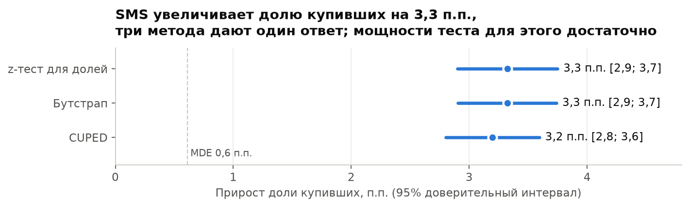
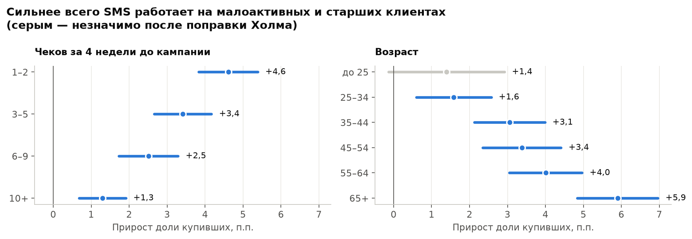

# A/B-тест SMS-рассылки X5: катить или нет

[](https://github.com/mvakh975-wq/x5-sms-ab-test/actions/workflows/ci.yml)

**Увеличивает ли SMS-рассылка долю покупателей, окупается ли она и на кого её направлять?**
Полный разбор реального рандомизированного эксперимента торговой сети X5 на 200 039 клиентах:
проверка сплита, мощность, z-тест, бутстрап, CUPED, сегменты с поправкой на множественные
сравнения и решение для бизнеса.

**[→ Ноутбук с анализом](notebooks/ab_test.ipynb)**



## Решение: слать малоактивным, остальным — после расчёта маржи и цены SMS

- **Эффект есть и он большой.** Купили 63,7% клиентов с SMS против 60,3% без SMS:
  +3,3 п.п. (+5,5% относительно), 95% ДИ [2,9; 3,7] п.п., p < 0,001. Бутстрап и CUPED дают
  тот же ответ. Чувствительность дизайна: при таких группах тест замечает прирост от 0,6 п.п.
  (MDE при мощности 80%).
- **Сплит корректен.** Группы разделены 49,98 / 50,02% (проверка SRM: p = 0,86). По возрасту, полу
  и покупкам до кампании группы не отличаются: стандартизированная разница средних < 0,01
  (883 клиента с ошибочным возрастом вне 14–100 лет в сравнении возраста не участвуют).
- **Окупаемость.** 1000 SMS дают около 33 дополнительных покупателей — примерно 14 ₽ дополнительной
  выручки на сообщение, если дополнительная покупка равна среднему чеку (427 ₽). Рассылка окупается,
  если стоимость SMS ниже этой суммы, умноженной на маржу (маржи в данных нет — её дают финансы).
  Для ориентира, если допустить маржу 20–25%: около 3 ₽ маржинального дохода
  на SMS по всей базе (до вычета цены самой SMS).
- **Кому слать.** Сильнее всего SMS действует на малоактивных клиентов (1–2 чека за месяц до кампании:
  +4,6 п.п.; средний чек у них 522 ₽ — около 24 ₽ выручки на SMS) и на клиентов 55+ (65+: +5,9 п.п.).
  У самых активных (10+ чеков) и без SMS покупают 90%: прирост +1,3 п.п. при среднем чеке 348 ₽ —
  около 4,5 ₽ на SMS, в 5 раз меньше (при той же марже — около 1 ₽ маржинального дохода,
  у малоактивных — 5–6 ₽).
  У клиентов до 25 лет эффект после поправки Холма незначим.
  Различия между сегментами — основание для следующего теста с таргетингом, а не доказанная причина.



## Как устроен анализ

1. **Данные.** [X5 Retail Hero](https://ods.ai/competitions/x5-retailhero-uplift-modeling)
   (файлы скачиваются с [зеркала на Kaggle](https://www.kaggle.com/datasets/mvyurchenko/x5-retail-hero)):
   `uplift_train.csv` — кто получил SMS (`treatment_flg`) и купил ли после коммуникации (`target`);
   `clients.csv` — возраст и пол; `purchases.csv` — 45,8 млн позиций чеков до кампании,
   свёрнутые DuckDB-запросом до 8 045 201 чека ([`scripts/prepare.py`](scripts/prepare.py)).
2. **Проверка сплита:** SRM (хи-квадрат против 50/50) и баланс признаков до кампании.
3. **Мощность:** MDE при фактическом размере групп, α = 0,05, мощность 80% (Statsmodels).
4. **Эффект:** z-тест для долей и интервал Вальда (Statsmodels), бутстрап как проверка.
5. **CUPED:** число чеков до кампании как ковариата снижает дисперсию метрики на 12,7%
   и сужает интервал: [2,8; 3,6] п.п.
6. **Сегменты:** активность до кампании и возраст; p-value с поправкой Холма сразу на все 10 сравнений.

Статистические функции — [`src/ab.py`](src/ab.py), покрыты тестами на значениях, посчитанных
вручную (`tests/`).

## Ограничения

- В эксперимент попали только клиенты с покупкой за последние 4 недели до кампании — выводы
  относятся к активной базе; на «спящих» клиентах эффект нужно проверять отдельно.
- Метрика бинарная: как SMS влияет на средний чек и частоту покупок, в данных не измерено.
  Поэтому выручка на SMS — оценка «одна дополнительная покупка = один средний чек».

## Как запустить

Нужны [uv](https://docs.astral.sh/uv/) и аккаунт Kaggle (`uv run kaggle auth login`).

```bash
uv sync
make data       # скачать файлы X5 Retail Hero (~600 МБ архив)
make checks     # свернуть позиции до чеков
make notebook   # выполнить ноутбук, графики — в docs/
make test
```

## Лицензия

Код — MIT. Данные опубликованы для открытого соревнования
[X5 RetailHero](https://ods.ai/competitions/x5-retailhero-uplift-modeling) и в репозиторий
не входят — скачиваются скриптом; в репозитории только код и агрегированные результаты.
